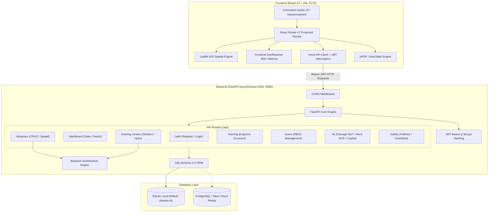
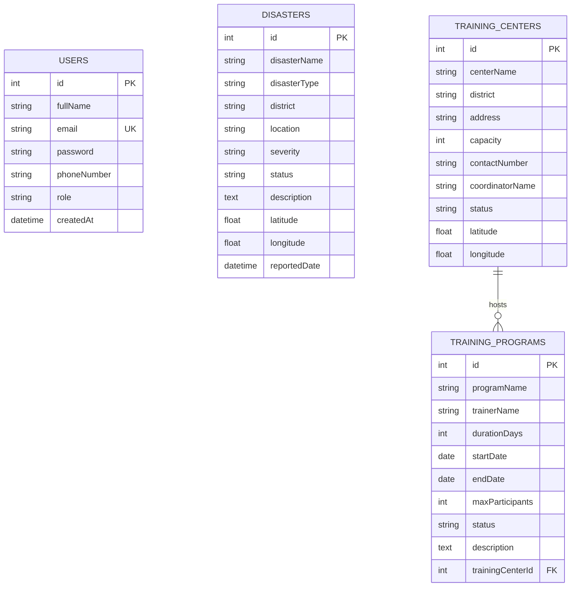

# 🌍 AI Disaster Operations & Response Management System
## Comprehensive Project Documentation & Technical Architecture Report

---

## 📑 Table of Contents
1. [Executive Summary](#1-executive-summary)
2. [System Architecture & Workflow](#2-system-architecture--workflow)
3. [Technology Stack](#3-technology-stack)
4. [Project Directory Structure](#4-project-directory-structure)
5. [Core Features & Modules Implemented](#5-core-features--modules-implemented)
   - [5.1 Interactive GIS Spatial Map & Threat Visualization](#51-interactive-gis-spatial-map--threat-visualization)
   - [5.2 Autonomous Geocoding & Coordinate Resolution Engine](#52-autonomous-geocoding--coordinate-resolution-engine)
   - [5.3 AI Operations & Crisis Intelligence Grid](#53-ai-operations--crisis-intelligence-grid)
   - [5.4 Incident Reporting & Operations Management](#54-incident-reporting--operations-management)
   - [5.5 Official SitRep PDF & CSV Export Engine](#55-official-sitrep-pdf--csv-export-engine)
   - [5.6 Relief Hubs & Training Centers Management](#56-relief-hubs--training-centers-management)
   - [5.7 Preparedness Training Programs & Relational Enrollment](#57-preparedness-training-programs--relational-enrollment)
   - [5.8 Safety Preparedness & Checklist Engine](#58-safety-preparedness--checklist-engine)
   - [5.9 Emergency SOS & Rapid GPS Dispatch](#59-emergency-sos--rapid-gps-dispatch)
   - [5.10 Real-Time Alert Notification System](#510-real-time-alert-notification-system)
   - [5.11 Authentication & Role-Based Access Control (RBAC)](#511-authentication--role-based-access-control-rbac)
   - [5.12 Modern Glassmorphism UI & Non-Blocking Validation](#512-modern-glassmorphism-ui--non-blocking-validation)
6. [Database Schema & Data Models](#6-database-schema--data-models)
7. [API Specifications & Endpoint Reference](#7-api-specifications--endpoint-reference)
8. [Implementation & Execution Walkthrough](#8-implementation--execution-walkthrough)
9. [Default Seed Credentials & Test Accounts](#9-default-seed-credentials--test-accounts)
10. [Production Deployment Architecture](#10-production-deployment-architecture)
11. [Verification & System Health Status](#11-verification--system-health-status)
12. [Recent Progress Milestones & Continuation Roadmap](#12-recent-progress-milestones--continuation-roadmap)

---

## 1. Executive Summary

The **AI Disaster Operations & Response Management System** is an end-to-end mission-critical emergency coordination platform. Developed to bridge the gap between real-time crisis reporting, automated situational awareness, resource coordination, and citizen safety, the platform integrates **FastAPI**, **React 19 (Vite)**, **Leaflet GIS Spatial Mapping**, and **AI Triage Automation**.

### Key Mission Objectives:
- **Instant Situational Awareness**: Real-time visualization of natural disasters (floods, fires, earthquakes, cyclones, landslides) with danger radius zones on an interactive GIS map.
- **Autonomous Location Intelligence**: Built-in 300+ district coordinate mapping across Indian states providing automated latitude/longitude lookup with manual GIS overrides.
- **AI-Driven Triage & Damage Assessment**: Automated classification of disaster damage severity, extraction of structured incident parameters from voice SOS messages, and 24/7 AI tactical copilot guidance.
- **Inter-Agency Coordination**: Role-based access control (Admin, Trainer, Participant) ensuring authorized resource allocation, training center shelter coordination, and disaster lifecycle tracking.
- **Auditable Incident Records**: One-click generation of official PDF Situation Reports (SitRep) conforming to national emergency response standards.

---

## 2. System Architecture & Workflow

The platform follows a decoupled, service-oriented client-server architecture with asynchronous communication, RESTful APIs, and persistent relational data storage.



---

## 3. Technology Stack

### Frontend Architecture
| Layer / Tool | Technology | Version | Purpose |
| :--- | :--- | :--- | :--- |
| **Framework** | React.js | `^19.2.7` | High-performance reactive UI rendering |
| **Build Tool** | Vite | `^8.1.0` | Ultra-fast HMR and production bundling |
| **Routing** | React Router DOM | `^7.18.0` | Dynamic client-side routing & protected route guard |
| **Mapping & GIS** | Leaflet & React-Leaflet | `^1.9.4` / `^5.0.0` | Interactive map tiles, circle buffers, custom SVG markers |
| **Geocoding** | Built-in GeoRegistry | Custom JS Module | 300+ Indian district to coordinate resolution |
| **Icons & Visuals** | Lucide React & React Icons | `^1.23.0` / `^5.7.0` | Clean, modern operational iconography |
| **Data Analytics** | Recharts | `^3.9.2` | Responsive visual charts (Pie, Bar, Area charts) |
| **CSS & Design** | Custom CSS + Bootstrap | `^5.3.8` | Glassmorphism, dark command center theme, responsive grid |
| **Report Generation** | jsPDF & jsPDF-AutoTable | `^4.2.1` / `^5.0.8` | Client-side official PDF SitRep compilation |
| **HTTP Client** | Axios | `^1.18.1` | Asynchronous REST calls with auto token injection |

### Backend Architecture
| Layer / Tool | Technology | Version | Purpose |
| :--- | :--- | :--- | :--- |
| **API Engine** | FastAPI | `^0.115.0` | High-speed asynchronous Python ASGI REST framework |
| **ASGI Server** | Uvicorn & Gunicorn | `^0.30.0` / `^22.0.0` | Production asynchronous web server |
| **ORM / Data Access** | SQLAlchemy | `^2.0.0` | Declarative relational database ORM |
| **Data Validation** | Pydantic v2 | `^2.8.0` | Strict type validation, serialization, and OpenAPI schemas |
| **Authentication** | python-jose & passlib | `^3.3.0` / `^1.7.4` | JWT token encoding/decoding & bcrypt password hashing |
| **Form & File Handling**| python-multipart | `^0.0.9` | Multipart file upload and form parsing for AI multimodal |
| **Geocoding Engine** | Regex / Dictionary Registry | Custom Python Module | Server-side location coordinate resolution fallback |
| **Database** | SQLite / psycopg2-binary | `^2.9.9` | SQLite zero-config local engine, PostgreSQL cloud driver |

---

## 4. Project Directory Structure

```text
disaster-management-system/
├── backend/
│   ├── data/
│   │   └── disaster.db               # Local SQLite operational database
│   ├── routers/
│   │   ├── ai.py                     # AI Multimodal damage, Voice SOS, and Copilot triage
│   │   ├── auth.py                   # User registration and JWT login
│   │   ├── dashboard.py              # Aggregated metrics and recent activity feeds
│   │   ├── disasters.py              # Incident lifecycle, CRUD, filtering & search
│   │   ├── safety.py                 # Emergency directory, checklists, guidelines
│   │   ├── training_centers.py       # Relief shelter hubs & coordinator contact
│   │   ├── training_programs.py      # Community preparedness training sessions
│   │   └── users.py                  # User management and role modification
│   ├── database.py                   # Engine configuration, session management, pooling
│   ├── geo_resolver.py               # 300+ Indian district coordinates resolver engine
│   ├── main.py                       # FastAPI entrypoint, CORS configuration, lifecycle
│   ├── models.py                     # SQLAlchemy ORM entity models
│   ├── requirements.txt              # Backend Python dependencies
│   ├── run.py                        # Uvicorn launcher (Port 8080)
│   ├── schemas.py                    # Pydantic schemas (Request/Response validation)
│   ├── security.py                   # Password hashing, JWT token verification, RBAC guard
│   ├── seed.py                       # Initial seeding dataset (Admin, Trainer, Sample data)
│   └── .env                          # Local environment variables
│
├── frontend/
│   ├── public/                       # Static public assets
│   ├── src/
│   │   ├── components/
│   │   │   ├── AlertBanner.jsx       # Real-time incident banner ticker
│   │   │   ├── Counter.jsx           # Animated stat numbers
│   │   │   ├── DashboardCard.jsx     # Overview analytical metric cards
│   │   │   ├── DashboardCharts.jsx   # Severity and district distribution charts
│   │   │   ├── DisasterMap.jsx       # Leaflet interactive GIS spatial map
│   │   │   ├── LoadingSpinner.jsx    # Accessible loading indicators
│   │   │   ├── Navbar.jsx            # Top navigation bar with active SOS trigger
│   │   │   ├── NotificationDropdown.jsx # Real-time alerts notification popover
│   │   │   ├── ProtectedRoute.jsx    # Role-based route authorization guard
│   │   │   ├── Sidebar.jsx           # Command center navigation drawer
│   │   │   └── SOSModal.jsx          # Emergency hotline & GPS location copier
│   │   ├── layouts/
│   │   │   └── MainLayout.jsx        # Shell layout integrating Navbar, Sidebar, and Ticker
│   │   ├── pages/
│   │   │   ├── Dashboard.jsx         # Executive command dashboard with live feeds
│   │   │   ├── Disasters.jsx         # Incident grid, filter engine, modal form, export
│   │   │   ├── Login.jsx             # Secure authentication portal
│   │   │   ├── NotFound.jsx          # Custom 404 error page
│   │   │   ├── Register.jsx          # New user registration portal
│   │   │   ├── SafetyPreparedness.jsx# Interactive checklists, guidelines, protocols
│   │   │   ├── TrainingCenters.jsx   # Relief shelter & center management
│   │   │   ├── TrainingPrograms.jsx  # Preparedness courses & relational enrollment
│   │   │   └── Users.jsx             # Admin user administration table
│   │   ├── services/
│   │   │   ├── api.js                # Axios client with JWT interceptors
│   │   │   ├── authService.js        # Auth API calls
│   │   │   ├── disasterService.js    # Disasters API calls
│   │   │   ├── safetyService.js      # Safety API calls
│   │   │   ├── trainingCenterService.js # Relief center API calls
│   │   │   ├── trainingProgramService.js# Training program API calls
│   │   │   └── userService.js        # User management API calls
│   │   ├── styles/                   # Modular CSS stylesheets
│   │   ├── utils/
│   │   │   ├── geoResolver.js        # Frontend Indian districts coordinate registry
│   │   │   └── reportGenerator.js    # jsPDF SitRep and CSV exporter
│   │   ├── App.jsx                   # Application routing and route definitions
│   │   ├── index.css                 # Global styling and CSS tokens
│   │   └── main.jsx                  # React DOM root mounting
│   ├── package.json                  # NPM packages & scripts
│   └── vite.config.js                # Vite build and proxy configuration
│
├── .gitignore                        # Git ignore rules
├── render.yaml                       # Cloud infrastructure blueprint for Render
├── README.md                         # Project overview and quickstart guide
└── PROJECT_DOCUMENTATION.md          # Comprehensive technical report
```

---

## 5. Core Features & Modules Implemented

### 5.1 Interactive GIS Spatial Map & Threat Visualization
- **Live Tile Rendering**: Uses Leaflet and OpenStreetMap tiles with high-contrast tactical dark styling.
- **Dynamic Threat Buffers**: Generates semi-transparent danger circles around incidents based on severity:
  - **HIGH Severity**: 22 km danger radius with pulsed red marker animations.
  - **MEDIUM Severity**: 14 km caution radius with amber warning pins.
  - **LOW Severity**: 8 km monitored radius with green pins.
- **Relief Center Spatial Pins**: Relief hubs and training centers are mapped concurrently with distinct blue shelter icons and capacity indicators.
- **Map Controls**: Layer toggling (All, Incidents Only, Centers Only), severity filters, and auto-zoom centering.

### 5.2 Autonomous Geocoding & Coordinate Resolution Engine
- **Cross-Platform Coordinate Engine**:
  - Implemented in Python (`backend/geo_resolver.py`) and JavaScript (`frontend/src/utils/geoResolver.js`).
  - Covers 300+ Indian districts across Himachal Pradesh, Uttarakhand, Tamil Nadu, Kerala, Karnataka, Maharashtra, Gujarat, Delhi, Uttar Pradesh, West Bengal, and more.
- **Zero-Friction Incident Reporting**: When operators enter district names (e.g., "Kullu", "Kangra", "Shimla", "Dehradun", "Wayanad"), the system immediately resolves accurate latitude/longitude coordinates automatically.
- **GIS Coordinate Override**: Direct decimal coordinate input fields (`latitude`, `longitude`) are available on modal dialogs with a live target coordinate badge to allow pinpoint accuracy.

### 5.3 AI Operations & Crisis Intelligence Grid
- **Multimodal Damage Assessment (`POST /api/ai/analyze-damage`)**:
  - Ingests damage descriptions and uploaded incident photos/files.
  - Uses NLP and heuristic rules to classify disaster type, calculate damage confidence rating, identify critical hazards, and recommend dispatch teams (USAR, Swiftwater Rescue, Hazmat).
- **Voice SOS Incident Extractor (`POST /api/ai/voice-report`)**:
  - Translates raw citizen distress speech transcripts into structured JSON incidents, parsing disaster type, detected district, and severity level.
- **24/7 AI Emergency Copilot (`POST /api/ai/copilot`)**:
  - Tactical assistant providing live step-by-step first-aid actions, flood/fire survival protocols, and querying the database for nearby operational relief centers.

### 5.4 Incident Reporting & Operations Management
- **Full Incident Lifecycle**: Supports creating, reading, updating, and resolving disaster events.
- **Comprehensive Filtering**: Multi-condition filtering by status (`ACTIVE`, `UNDER_CONTROL`, `RESOLVED`), severity (`HIGH`, `MEDIUM`, `LOW`), district, disaster type, and full-text keyword search.
- **Sorting Options**: Sort by newest, oldest, or highest severity.

### 5.5 Official SitRep PDF & CSV Export Engine
- **PDF Situation Report (SitRep)**:
  - Built using `jsPDF` and `jsPDF-AutoTable`.
  - Professional command header, emergency classification badges, aggregated statistical summaries (Total Incidents, Active Crises, High Severity counts), timestamped audit trail, and formatted incident tables.
- **CSV Data Export**:
  - Instant one-click CSV export of filtered incident logs for external GIS or spreadsheet analysis.

### 5.6 Relief Hubs & Training Centers Management
- **Shelter Directory**: Monitors relief centers and training hubs across districts.
- **Capacity & Coordinator Tracking**: Manages center capacity, coordinator contact info, and operational readiness.
- **Geographic Auto-Tagging**: Relief center addresses auto-resolve to GIS map pins.

### 5.7 Preparedness Training Programs & Relational Enrollment
- **Course Scheduling**: Organizes community resilience courses (First Aid, Flood Rescue, Fire Safety).
- **Relational Center Linking**: Instead of requiring operators to manually type obscure numeric foreign keys, programs are directly linked to designated training centers via an interactive relational dropdown selector (`{centerName} ({district})`).
- **Participant Registration**: Community members can enroll in programs with status saved persistently in browser storage.

### 5.8 Safety Preparedness & Checklist Engine
- **Multi-Hazard Preparedness Guides**: Comprehensive guides for Floods, Cyclones, Earthquakes, Fires, Landslides, and Heatwaves.
- **Phased Action Protocols**: Categorized action steps across **BEFORE**, **DURING**, and **AFTER** a disaster strike.
- **Interactive Checklists**: Persisted interactive check-off items using browser `localStorage` to help citizens track emergency kit preparations.
- **Direct Hotline Access**: One-touch national helpline directories with direct click-to-call links.

### 5.9 Emergency SOS & Rapid GPS Dispatch
- **1-Click GPS Locator**: Fetches device browser geolocation coordinates (`lat`, `lng`, accuracy) and copies them to clipboard for emergency transmission.
- **Quick Hotline Directory**: Immediate access to Police (100/112), Fire (101), Ambulance (108), Disaster Management Helpline (1077/1070), and Women Helpline (1091).

### 5.10 Real-Time Alert Notification System
- **Alert Banner Ticker**: Top banner scanning active high-severity incidents across districts to alert operators immediately.
- **Notification Dropdown**: Popover list of recent events with timestamped badges and mark-as-read capability.

### 5.11 Authentication & Role-Based Access Control (RBAC)
- **Token-Based Security**: Cryptographically signed JSON Web Tokens (`python-jose`) with HS256 algorithm.
- **Password Security**: Salted Bcrypt hashing (`passlib[bcrypt]`).
- **Role Permissions**:
  - `ADMIN`: Full administrative control across Disasters, Training Centers, Training Programs, and Users management.
  - `TRAINER`: Incident creation/updates, training program scheduling, and relief center coordination.
  - `PARTICIPANT`: Read-only access to maps, emergency directories, safety checklists, and AI Copilot assistance.
- **Client Route Guards**: `ProtectedRoute` component enforcing authentication and matching authorized role lists.

### 5.12 Modern Glassmorphism UI & Non-Blocking Validation
- **Polished Command Center Aesthetic**: Sleek dark palette with neon status indicators and glassmorphism cards.
- **Non-blocking Error Banners**: Upgraded form modals across Login, Register, Users, Disasters, Training Centers, and Training Programs to replace intrusive browser `alert()` popups with styled inline error and validation alerts.

---

## 6. Database Schema & Data Models

The relational database uses SQLAlchemy ORM mapping to SQLite (`backend/data/disaster.db`) or PostgreSQL.



---

## 7. API Specifications & Endpoint Reference

Base URL: `http://localhost:8080` (Local) / `/api` prefix

### Authentication (`/api/auth`)
| Method | Endpoint | Access | Description |
| :--- | :--- | :--- | :--- |
| `POST` | `/api/auth/register` | Public | Register a new user account |
| `POST` | `/api/auth/login` | Public | Login with email & password, returns JWT token |
| `GET` | `/api/auth/me` | Authenticated | Retrieve current user profile |

### Dashboard & Analytics (`/api/dashboard`)
| Method | Endpoint | Access | Description |
| :--- | :--- | :--- | :--- |
| `GET` | `/api/dashboard` | Authenticated | Overall statistics (Users, Disasters, Centers, Programs) |
| `GET` | `/api/dashboard/recent-disasters` | Authenticated | Retrieve 10 most recent reported incidents |
| `GET` | `/api/dashboard/recent-programs` | Authenticated | Retrieve 10 most recent preparedness programs |

### Disasters Operations (`/api/disasters`)
| Method | Endpoint | Access | Description |
| :--- | :--- | :--- | :--- |
| `GET` | `/api/disasters` | Authenticated | Filtered query of incidents (search, severity, status, district) |
| `GET` | `/api/disasters/{id}` | Authenticated | Get incident by ID |
| `POST` | `/api/disasters` | Admin, Trainer | Create a new disaster report (with auto-geocoding) |
| `PUT` | `/api/disasters/{id}` | Admin, Trainer | Update an existing disaster report |
| `DELETE` | `/api/disasters/{id}` | Admin | Delete a disaster record |

### Training Centers (`/api/training-centers`)
| Method | Endpoint | Access | Description |
| :--- | :--- | :--- | :--- |
| `GET` | `/api/training-centers` | Authenticated | List all relief centers & training hubs |
| `GET` | `/api/training-centers/{id}` | Authenticated | Get training center details |
| `POST` | `/api/training-centers` | Admin, Trainer | Create a new training/relief center |
| `PUT` | `/api/training-centers/{id}` | Admin, Trainer | Update training center details |
| `DELETE` | `/api/training-centers/{id}` | Admin | Delete a training center |

### Training Programs (`/api/training-programs`)
| Method | Endpoint | Access | Description |
| :--- | :--- | :--- | :--- |
| `GET` | `/api/training-programs` | Authenticated | List all community resilience courses |
| `GET` | `/api/training-programs/{id}`| Authenticated | Get training program details |
| `POST` | `/api/training-programs` | Admin, Trainer | Schedule a new training program |
| `PUT` | `/api/training-programs/{id}`| Admin, Trainer | Update a training program |
| `DELETE` | `/api/training-programs/{id}`| Admin | Delete a training program |

### AI Operations (`/api/ai`)
| Method | Endpoint | Access | Description |
| :--- | :--- | :--- | :--- |
| `POST` | `/api/ai/analyze-damage` | Authenticated | Multimodal damage severity analysis from text/photo |
| `POST` | `/api/ai/voice-report` | Authenticated | AI voice SOS transcript to structured incident JSON |
| `POST` | `/api/ai/copilot` | Authenticated | 24/7 AI Triage Assistant for first-aid & tactical advice |

### Safety & Emergency Directory (`/api/safety`)
| Method | Endpoint | Access | Description |
| :--- | :--- | :--- | :--- |
| `GET` | `/api/safety/types` | Authenticated | List supported disaster safety categories |
| `GET` | `/api/safety/guidelines/{type}` | Authenticated | Phased Before/During/After emergency protocols |
| `GET` | `/api/safety/contacts` | Authenticated | National and regional emergency hotline directory |

### User Management (`/api/users`)
| Method | Endpoint | Access | Description |
| :--- | :--- | :--- | :--- |
| `GET` | `/api/users` | Admin | Retrieve all registered users |
| `GET` | `/api/users/{id}` | Admin | Retrieve specific user details |
| `PUT` | `/api/users/{id}/role` | Admin | Update user role (`ADMIN`, `TRAINER`, `PARTICIPANT`) |
| `DELETE` | `/api/users/{id}` | Admin | Remove user account |

---

## 8. Implementation & Execution Walkthrough

### How the Environment Was Launched and Verified:

1. **Environment Discovery**:
   - Python 3.12 / 3.14 compatible environment at `backend/venv`.
   - Node.js dependencies resolved in `frontend/node_modules`.

2. **Backend Execution**:
   - Executed via:
     ```powershell
     cd backend
     .\venv\Scripts\python.exe run.py
     ```
   - Launched Uvicorn server bound to `http://0.0.0.0:8080`.
   - Verified `/health` returns `{"status":"HEALTHY","code":200}`.
   - Database auto-seeded via `seed.py`.

3. **Frontend Execution**:
   - Executed via:
     ```powershell
     cd frontend
     npm run dev
     ```
   - Launched Vite development server listening on `http://localhost:5173`.
   - Verified HTTP status code 200 via curl test.

---

## 9. Default Seed Credentials & Test Accounts

| Role | Email Address | Password | Permissions & Scope |
| :--- | :--- | :--- | :--- |
| **Admin** | `admin@disaster.com` | `admin123` | Full access: CRUD disasters, manage centers, programs, and edit user roles |
| **Trainer** | `trainer@disaster.com` | `trainer123` | Operational access: Report disasters, schedule training sessions, view maps |
| **Participant** | `user@disaster.com` | `user123` | Citizen access: View maps, read safety guides, interact with AI Copilot, trigger SOS |

---

## 10. Production Deployment Architecture

The repository includes a ready-to-deploy **Render Blueprint** (`render.yaml`):

```yaml
services:
  # Backend ASGI Service (FastAPI)
  - type: web
    name: disaster-backend
    runtime: python
    rootDir: backend
    buildCommand: pip install -r requirements.txt
    startCommand: gunicorn -w 2 -k uvicorn.workers.UvicornWorker main:app --bind 0.0.0.0:$PORT
    envVars:
      - key: ENVIRONMENT
        value: production
      - key: JWT_SECRET_KEY
        generateValue: true
      - key: DATABASE_URL
        sync: false   # Neon / PostgreSQL connection string
      - key: FRONTEND_URL
        sync: false   # Deployed Frontend URL

  # Frontend Static Service (React/Vite)
  - type: web
    name: disaster-frontend
    runtime: node
    rootDir: frontend
    buildCommand: npm install && npm run build
    staticPublishPath: dist
    envVars:
      - key: VITE_API_BASE_URL
        sync: false   # Render Backend URL + /api
```

---

## 11. Verification & System Health Status

| Component | Port / Target | Operational Status | Verified Features |
| :--- | :--- | :--- | :--- |
| **Backend API** | `http://localhost:8080` | **HEALTHY / ONLINE** | Auth, Dashboard, Disasters CRUD, AI Endpoints |
| **Interactive Docs** | `http://localhost:8080/docs`| **ACCESSIBLE** | Interactive OpenAPI / Swagger UI testing suite |
| **Frontend Application**| `http://localhost:5173` | **HEALTHY / ONLINE** | Reactive UI, GIS Leaflet map, SitRep PDF export, SOS modal |
| **Database** | `backend/data/disaster.db` | **INITIALIZED** | Multi-table schema with relational constraints & seed data |

---

## 12. Recent Progress Milestones & Continuation Roadmap

### 🏁 Milestones Completed
1. **Autonomous Geocoding Infrastructure**:
   - Integrated `geo_resolver.py` (backend) and `geoResolver.js` (frontend) with 300+ Indian districts.
   - Disaster and Training Center creation dynamically auto-calculates spatial coordinates from district or location names.
   - Added manual GIS coordinate controls and real-time visual coordinate badges on incident dialogs.
2. **Relational Form Upgrades**:
   - Transformed Training Programs form from manual numeric foreign key entry to dynamic dropdown selector mapped to existing relief centers.
   - Integrated persistent registration state using `localStorage`.
3. **UI / UX Non-Blocking Modernization**:
   - Modernized error handling across all pages, replacing browser modal `alert()` popups with inline glassmorphic error banners.
4. **Full-Stack Execution & Verification**:
   - Backend online on `http://localhost:8080` (FastAPI).
   - Frontend online on `http://localhost:5173` (React 19 / Vite).
   - Swagger documentation verified at `http://localhost:8080/docs`.

### 🚀 Future Roadmap & Continuation Tasks
- **Task 1: Real-Time WebSocket Alerts**: Establish WebSocket channel (`/ws/alerts`) to broadcast newly reported disasters to all active operator consoles in real time without manual page refreshes.
- **Task 2: Weather & Precipitation Overlay**: Integrate external weather/cyclone data (NOAA or OpenWeather) to project weather radars directly over the Leaflet GIS canvas.
- **Task 3: Citizen SMS / WhatsApp Ingestion**: Provide an inbound webhook for low-connectivity SMS or WhatsApp incident distress messages.
- **Task 4: Offline PWA Capabilities**: Add Service Worker caching for offline emergency guide access during severe power or cellular infrastructure disruption.
- **Task 5: Production Cloud Deployment**: Deploy backend and frontend to Render using `render.yaml` with managed PostgreSQL.

---

*Documentation maintained and up to date with current codebase state.*
